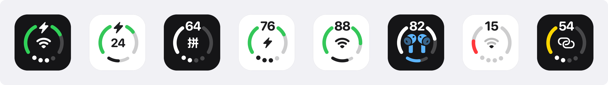
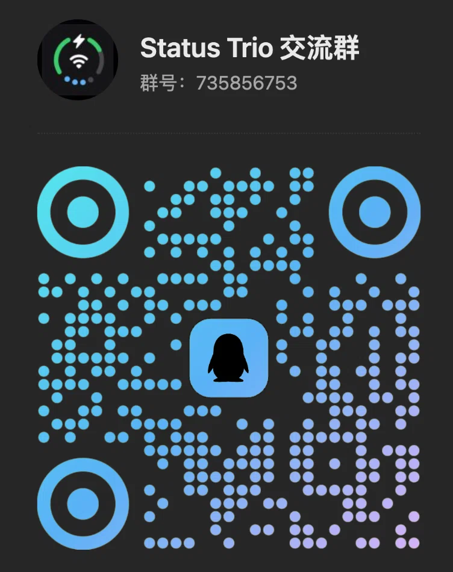

<p align="center">
  
</p>

<p align="center">
  
</p>

<h1 align="center">Status Trio</h1>

<p align="center">
  <a href="https://trendshift.io/repositories/234371?utm_source=trendshift-badge&utm_medium=badge&utm_campaign=badge-trendshift-234371" target="_blank" rel="noopener noreferrer"></a>
</p>

<p align="center"><strong>三个系统状态，一个原生 macOS 状态图标 —— 可放在菜单栏或程序坞。</strong></p>

<p align="center">
  <a href="https://github.com/lingyired/status-trio/releases/latest"></a>
</p>

<p align="center">
  想先看看实际效果？打开 <a href="https://statustrio.lingai.net/">statustrio.lingai.net</a>，即可在浏览器里模拟预览各种图标状态。
</p>

<p align="center">
  <a href="https://github.com/lingyired/status-trio/releases/latest"></a>
  <a href="https://github.com/lingyired/status-trio/actions/workflows/release.yml"></a>
  <a href="LICENSE"></a>
</p>

<p align="center">
  
  
</p>

<p align="center">
  <a href="README.md">English</a> ·
  <strong>简体中文</strong> ·
  <a href="README.zh-Hant.md">繁體中文</a> ·
  <a href="README.ja.md">日本語</a> ·
  <a href="README.ko.md">한국어</a> ·
  <a href="README.es.md">Español</a> ·
  <a href="README.fr.md">Français</a> ·
  <a href="README.de.md">Deutsch</a> ·
  <a href="README.pt-BR.md">Português (Brasil)</a> ·
  <a href="README.ru.md">Русский</a>
</p>

<p align="center">
  
</p>

Status Trio 是一个原生 macOS 状态应用，将 Wi-Fi、电池和音量整合进一个紧凑、可配置的图标，可显示在菜单栏、程序坞，或两处同时显示。弹出面板比图标本身更深入：Wi-Fi 面板可查看附近网络与链路详情，蓝牙面板列出已配对设备，还有电池详情页，以及当前正在播放的音频设备。灵感源自 iPhone Duo 将 Wi-Fi、电池和蜂窝网络合并展示的状态栏图标，并在 Mac 上以音量替代蜂窝网络。

> Status Trio 是独立项目，与 Apple 无隶属关系。

## 主要特性

- **三合一图标**：电池、Wi-Fi 和音量共用一个图标，放在菜单栏、程序坞或两处都行；播放蓝牙音频时，设备自己的图标可以接管中间的位置。
- **蓝牙**：播放时音量指示会变成蓝色。面板列出已配对设备，点一下即可连接或断开，电量默认显示；面板默认不显示，需要时再打开。
- **电池**：电量百分比、充电或已接电源、充满预计时间，电量偏低时会变色；点开可以看适配器功率、电压、电流、循环次数和低电量模式。
- **Wi-Fi**：显示当前网络和信号强度，也能查看附近网络、链路详情，或直接关掉 Wi-Fi。切换网络请在系统设置的 Wi-Fi 面板中操作。
- **音量**：音量大小、静音状态和输出设备，样式可选圆点或圆弧；在面板或音量控件上滚动都能调节，方向也能选。
- **按自己的习惯调整**：图标大小、图标缩放、圆环粗细、状态颜色，以及面板显示哪些区块、按什么顺序排列。
- **菜单栏、程序坞或两处**：程序坞图标可以跟随系统样式，也可以固定为深色或浅色。
- **原生 macOS 操作**：左键打开面板，右键打开菜单，首次启动有引导说明图标每一部分；有线连接、热点或互联网共享也可以继续显示 Wi-Fi 图标。
- **保持最新**：状态由系统事件驱动、低频轮询兜底，Sparkle 通过已签名的更新源更新应用。
- **其他**：十二种语言，以及可选的开机时启动。

## 安装

通过 Homebrew 官方 Cask 安装：

```bash
brew install --cask status-trio
```

更新已通过 Homebrew 安装的版本：

```bash
brew upgrade --cask status-trio
```

也可以从 [GitHub Releases](https://github.com/lingyired/status-trio/releases/latest) 下载最新的 `StatusTrio-*.dmg`，打开后将 `Status Trio.app` 拖入 `/Applications`。

官方发行版已使用 Developer ID 签名并通过 Apple 公证。安装后正常打开即可，无需执行移除隔离属性的命令。应用内更新由 Sparkle 提供，并验证 EdDSA 签名。

## 输入法、音频与日常控制

- **输入法图标**：菜单栏和程序坞的中部图标可改为显示当前输入法，在**设置 › 应用图标 › 中间图标**中选择；也可以在面板中选择已启用的输入法并切换。
- **全局快捷键**：在**设置 › 通用**中设置快捷键，即可从其他应用打开或关闭状态面板，默认不绑定。
- **蓝牙控制**：直接在面板开关蓝牙、连接或断开已配对设备，并切换受支持 AirPods 和 HUAWEI FreeBuds 的聆听模式。可选的苹果设备电量行在**设置 › 蓝牙**中配置，能否读取取决于设备与连接方式。
- **音频输入与输出**：选择扬声器或麦克风、调节输出与输入音量，并通过 DDC 控制兼容的外接显示器扬声器；显示器音量控制取决于硬件及连接方式。
- **充电与外观**：菜单栏和程序坞均可开启充电特效；在 macOS 26 及更高版本中，Finder 和启动台里的应用图标也会跟随系统深浅色外观。

## main 分支新功能（尚未发布）

以下功能已合入 `main` 源码，尚未包含在当前 GitHub / Homebrew 公开版 **1.7.5** 中：

- **电池功率流向与 CPU 能耗影响**：电池面板可显示充电器输入、充入电池和系统供电的估算功率。可选列表按 CPU 能耗列出最多五个应用，能耗计数不可用时回退到 CPU 活跃度；它不代表应用全部能耗，也不是 macOS 原生高耗能名单的副本。开启列表后会定期后台采样，关闭即停止。详见[功率流向与 CPU 能耗说明](docs/battery-power-flow.md)。
- **立即充满电与取消**：在受支持的 Apple 芯片 Mac、macOS 26.4 及更高版本上，可通过按钮解除原生充电上限。该功能使用私有 PowerUI 接口，仅在能力可用时默认开启，可在电池设置中关闭。**充满或拔插电源后，上限可能仍保持 100%，不会自动恢复。** 请使用**取消立即充满**请求恢复，或在系统设置中检查并恢复上限；可用性与行为取决于 macOS。详见[行为与验证记录](docs/charge-to-full-now-poc.md)。

## 蓝牙音频

在 **设置 › 应用图标 › 中间图标** 中把中间图标设为「蓝牙设备」，播放蓝牙音频时中部图标就会变成该设备自身的图标（AirPods、耳机、音箱等设备各自提供自己的图标），音量圆点或圆弧也可以变成蓝色。默认开启的**优先显示网络异常**会在连接本身异常时保留网络图标。同一个选择器还可以选择网络、当前输入法、电池百分比或功耗：

<p align="center">
  
</p>

弹层中的蓝牙行会显示实时状态：已连接设备的名称，以及 AirPods 的左耳、右耳和充电盒电量。蓝牙面板列出已配对设备及其连接状态：点一下设备即可连接，再点一下已连接的设备即可断开，键盘、鼠标、触控板和手柄会先在行内确认。面板默认关闭，需在**设置 › 状态面板**中开启，首次使用会请求蓝牙权限。**设置 › 蓝牙**还可以控制是否读取电量（默认开启）、列出已配对设备供你拖动排序并设定显示数量，并把蓝牙图标在 100%–180% 之间缩放。

## 程序坞图标

同一个实时图标也可以放在程序坞，而不是菜单栏，或两处同时显示：

<p align="center">
  
  <br>
  <sub>程序坞图标（暗色外观）</sub>
</p>

<p align="center">
  
  <br>
  <sub>程序坞图标（亮色外观）</sub>
</p>

<p align="center">
  
  <br>
  <sub>蓝牙区块预览</sub>
</p>

程序坞图标绘制的是和菜单栏一致的三合一图标，中间图标选择「蓝牙设备」后，设备图标同样会取代中部图标。它的背景可以跟随系统图标样式，也可以固定为深色或浅色：

<p align="center">
  
</p>

## 图标状态

三合一图标支持的全部状态，均由应用自身的渲染器绘制 —— 顶部是电池指示，中部是 Wi-Fi 状态（开启该选项后蓝牙音频设备可取代它），底部是音量圆点或圆弧，播放蓝牙音频时会变成蓝色：

<p align="center">
  
</p>

同一批状态在深色菜单栏下的渲染：

<p align="center">
  
</p>

## 系统要求

- 运行 app 需要 macOS 13 部署目标（Ventura 运行验证待完成）
- 构建需要 Swift 6 工具链及 macOS 26 或更新的 SDK；正式发布使用 `xcode-27` runner 和 Xcode 27。
  用更旧的 SDK 构建会静默产出 Tahoe 之前的弹出面板观感，因此 `scripts/build-app.sh` 在 SDK 低于 26 时会直接失败。

## 从源码运行

```bash
git clone https://github.com/lingyired/status-trio.git
cd status-trio
swift run StatusTrio
```

## 构建本地应用

构建 ad-hoc 签名的应用包并启动：

```bash
bash scripts/build-app.sh release
```

应用包位于 `dist/StatusTrio.app`。如果只想构建，不退出或启动现有实例：

```bash
bash scripts/build-app.sh release no-open
```

ad-hoc 签名的应用包适合本地个人使用。如果应用包携带 quarantine 元数据后转移，可能会被 Gatekeeper 拦截。

## 使用方法

- **左键点击**菜单栏图标或程序坞图标，打开状态弹层。
- **右键点击**图标，显示原生菜单，其中包含版本和退出操作。
- 在弹层中点击 Wi-Fi 或电池行会打开对应页面：Wi-Fi 详情与附近网络、电池详情。蓝牙行则直接在行下列出已配对设备（点一下连接或断开），放不下时用「展开」查看。
- 打开**设置**可以选择图标显示位置（菜单栏 / 程序坞 / 两处），并调整图标大小、颜色、圆环粗细、面板区块及顺序、滚动调节音量行为、语言、更新检查和开机时启动。
- 可随时从**设置 › 应用图标 › 打开指引**重新查看**认识你的图标**引导。
- 如需显示当前 Wi-Fi 网络名称，请按提示启用定位权限；这是可选功能。

## 已知限制

有两条边界，是 macOS 与本项目各自有意划下的。详细说明见[已知限制](docs/known-limitations.md)。

- **切换网络在系统设置里完成。** 在弹层里选择网络会打开 Wi-Fi 面板；Status Trio 从不读取也不保存 Wi-Fi 密码——macOS 没有用已保存密码连接的公开 API，而其他做法最后都会让 app 持有你的密码。
- **充电上限控制取决于版本。** 公开版 1.7.5 通过系统设置操作；`main` 中的可选按钮使用私有接口，需要主动取消来请求恢复上限，详见 [main 分支新功能](#main-分支新功能尚未发布)。低电量模式由独立的[可选特权 Helper](docs/privileged-helper.md)处理。

## 支持的语言

Status Trio 默认跟随 macOS 首选语言，支持 English、简体中文、繁体中文、日本語、한국어、Español、Français、Deutsch、Italiano、Português (Brasil)、Русский 和 العربية。

## 交流群

Status Trio 设有中文交流群，欢迎反馈问题、交流使用体验和了解版本动态。

- **QQ 群：** `735856753` — 扫描下方二维码加入。
- **微信群：** 扫描下方二维码加入。

<p align="center">
  
  &nbsp;&nbsp;
  
</p>

## 隐私

Status Trio 在本机读取系统状态。匿名使用统计为可选功能，只有主动开启后才会向第一方服务发送简短心跳；升级用户默认关闭，新安装用户会在引导中选择。心跳包含随机安装 ID、应用和 macOS 版本、语言及图标位置，不包含姓名、账户详情、网络详情或硬件标识符。详见[遥测与隐私说明](docs/privacy-telemetry.md)。Status Trio 不读取或保存 Wi-Fi 密码，也不请求钥匙串访问。定位权限仅用于可选的当前 Wi-Fi 名称与详情；蓝牙权限在启用蓝牙面板时请求。`main` 中可选的立即充满电控制仅在启用后使用私有 PowerUI 接口，行为与限制见前文。

## 开发

按修改风险运行本地验证：

```bash
bash scripts/verify-local.sh quick BatteryMonitorTests
bash scripts/verify-local.sh docs
bash scripts/verify-local.sh full
```

小范围代码改动使用 `quick`，文档或本地化改动使用 `docs`，状态、并发、渲染、Helper 或构建流程改动使用 `full`。
`full` 生成非 Universal 的本地开发应用，不代表签名、公证或正式发布验证。

只需运行指定 Swift 测试时，使用统一入口：

```bash
bash scripts/test.sh BatteryMonitorTests
```

在主应用之外运行 worktree 构建：

```bash
bash scripts/build-worktree.sh release
```

该脚本会根据当前分支生成开发版 bundle identifier 和显示名称，也可以通过环境变量覆盖：

```bash
BUNDLE_ID=com.lingsmbp.StatusTrio.dev.settings-redesign \
APP_NAME="Status Trio (Settings Redesign)" \
bash scripts/build-worktree.sh release
```

单实例锁按 bundle identifier 隔离，因此不同标识的构建可以同时运行。

## 技术基线

- Swift 6
- SwiftUI + AppKit
- macOS 13 deployment target (Ventura runtime validation pending)
- `LSUIElement` 菜单栏辅助应用，显示程序坞图标时切换为常规应用策略
- 使用 Sparkle 检查更新

## 文档

- [已知限制](docs/known-limitations.md)
- [电池功率流向与 CPU 能耗影响](docs/battery-power-flow.md)
- [立即充满电：行为与验证](docs/charge-to-full-now-poc.md)
- [全局快捷键](docs/status-panel-global-shortcut.md)
- [GitHub Actions 自动发布](docs/github-actions-release.md)
- [Status Trio 设计规格](docs/superpowers/specs/2026-09-12-status-trio-design.md)
- [菜单栏图标 SVG](status-menubar.svg)
- [数据驱动图标演示](status-menubar-demo.html)

## 许可证

Copyright 2026 lingyired。

本项目采用 Apache License 2.0 许可。详见 [LICENSE](LICENSE) 和 [NOTICE](NOTICE)。

随应用分发的第三方组件采用各自的许可证，不会改变本项目整体的 Apache License 2.0 许可：

- [第三方许可证与依赖声明](docs/legal/third-party-licenses.md)
- [第三方源码与构建／替换说明](Support/MobileBatteryHelper/ThirdPartyNotices/NOTICE.md)

## 作者

由 [lingyired](https://github.com/lingyired) 创建并维护。<br>
主页：[https://statustrio.lingai.net/](https://statustrio.lingai.net/)

## Star History

<a href="https://www.star-history.com/?repos=lingyired%2Fstatus-trio&type=date&legend=top-left">
 <picture>
   <source media="(prefers-color-scheme: dark)" srcset="https://api.star-history.com/chart?repos=lingyired/status-trio&type=date&theme=dark&legend=top-left" />
   <source media="(prefers-color-scheme: light)" srcset="https://api.star-history.com/chart?repos=lingyired/status-trio&type=date&legend=top-left" />
   
 </picture>
</a>
