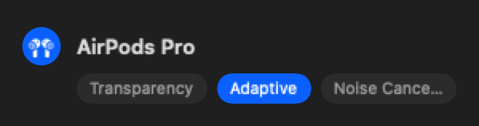
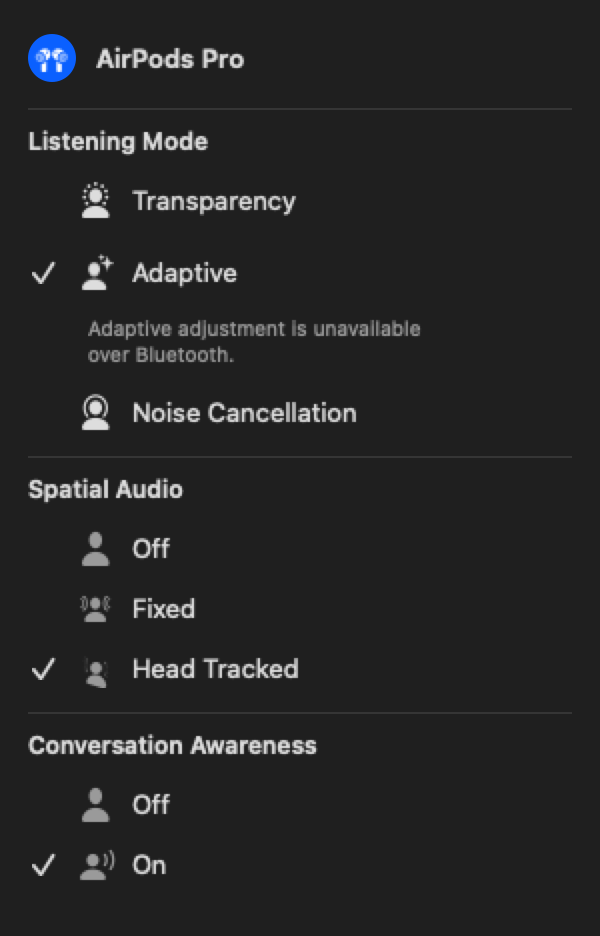
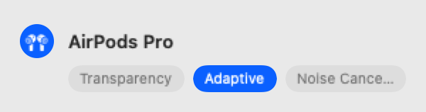
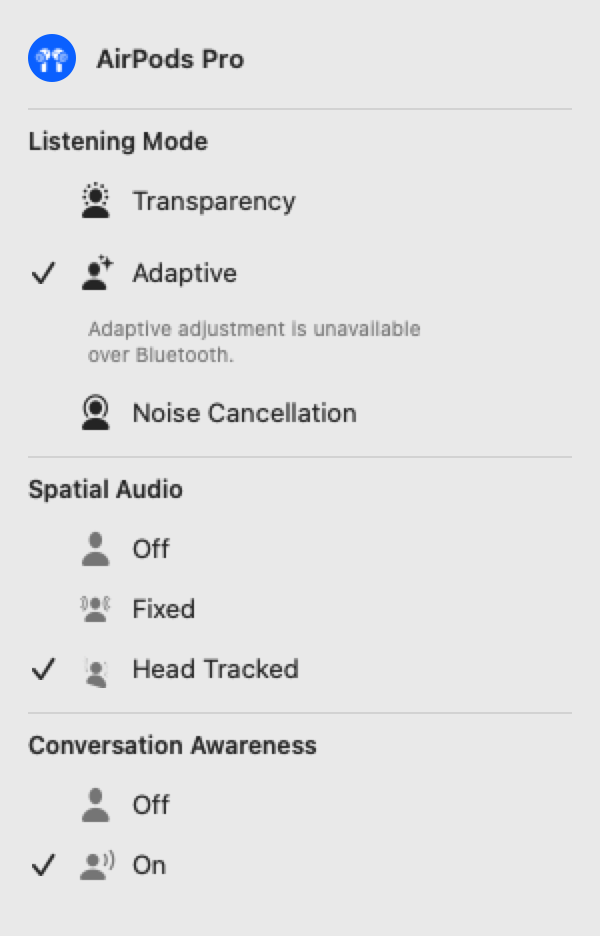

# AirPods controls comparison

Rendered UI previews for PR #264, generated on November 4, 2026 with the existing
AppKit/SwiftUI test harness. These use fixed sample state, not a live headset or
screenshots of Apple's Control Center. The before view uses the unchanged
listening-mode capsule control; the after view composes the expanded AirPods
controls beneath the same device header. The disclosure button and surrounding
status panel are omitted from this focused comparison.

Adaptive strength is intentionally unavailable in the after preview. Selected
Spatial Audio and Conversation Awareness values illustrate the layout and do not
represent a new hardware verification.

| Before (dark) | After (dark) |
| --- | --- |
|  |  |

| Before (light) | After (light) |
| --- | --- |
|  |  |

To reproduce:

```sh
mkdir -p .build/airpods-pr264-comparison
AIRPODS_PREVIEW_DIR="$PWD/.build/airpods-pr264-comparison" bash scripts/verify-local.sh quick AirPodsInlineControlsTests
```
