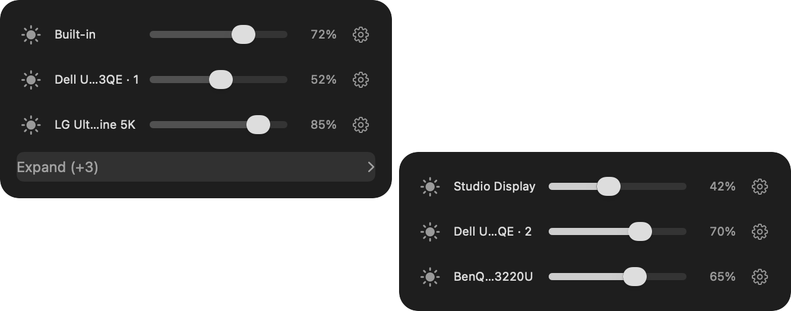
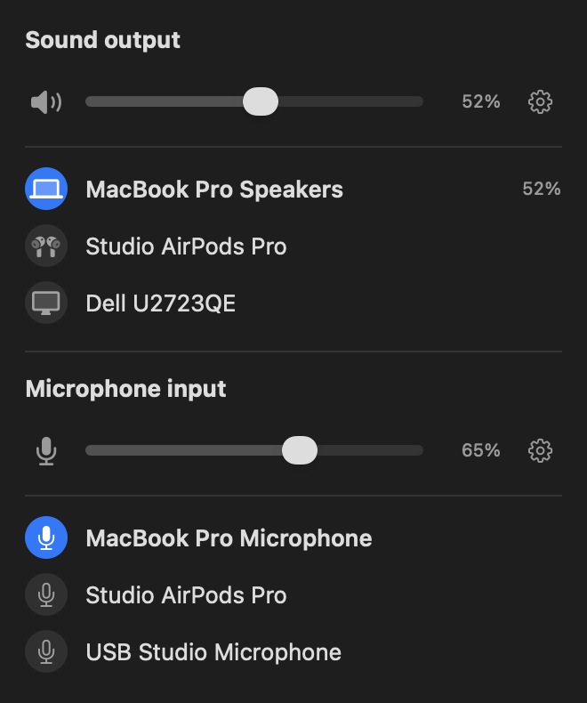
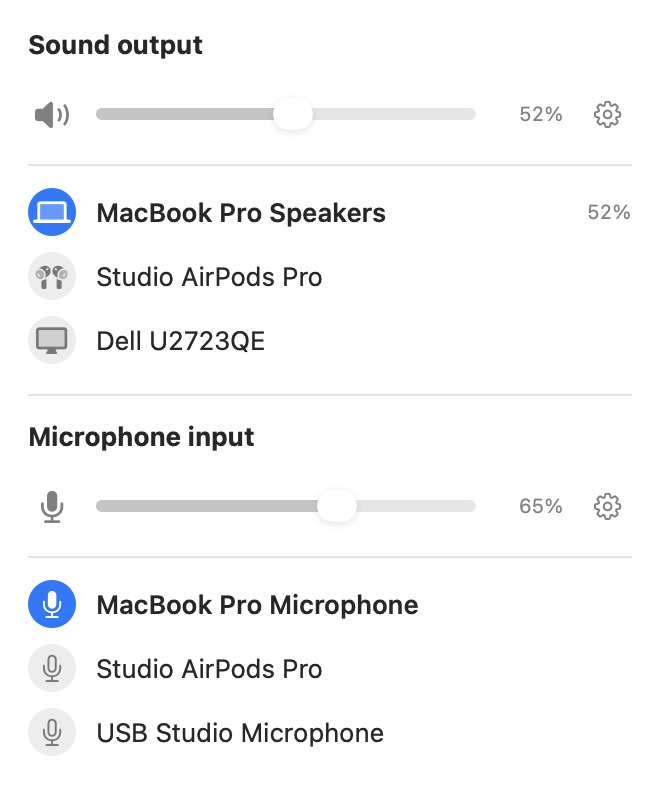
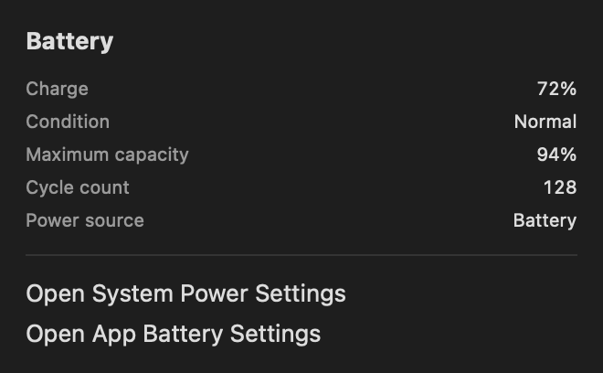

# Native panel controls and cascading subpanels

These images capture the shipping SwiftUI/AppKit views with injected synthetic display, audio, and battery state. They contain no live device names, network details, or hardware measurements.

- Six displays: first three in the main panel, remaining three in the child. The native view caches are composed using the observed window geometry (6 pt gap; child top aligned to the overflow entry). This is a view composite, not an OS desktop capture or a six-monitor hardware test.
- Audio: the actual output and input control views are grouped under fixture section labels, with three devices each, output52% and input65%. Hidden buffered windows provide Retina backing without ordering or activation.
- Battery: synthetic detail content in submenu mode.









Reproduce using the existing test entrypoint (the display fixture briefly presents owned native test windows):

```bash
STATUS_TRIO_PR_SCREENSHOTS_DIR=output/pr-screenshots bash scripts/test.sh PanelSliderScreenshotsTests
STATUS_TRIO_ALLOW_VISIBLE_UI_TESTS=1 STATUS_TRIO_BRIGHTNESS_PREVIEW_DIR=output/pr-screenshots bash scripts/test.sh BrightnessControlsInteractionTests
```

These images demonstrate layout and control states. They do not establish physical multi-display/audio compatibility, CPU performance, macOS13 runtime compatibility, or zero foreground interference. No real audio or brightness commands are sent by the fixtures.
